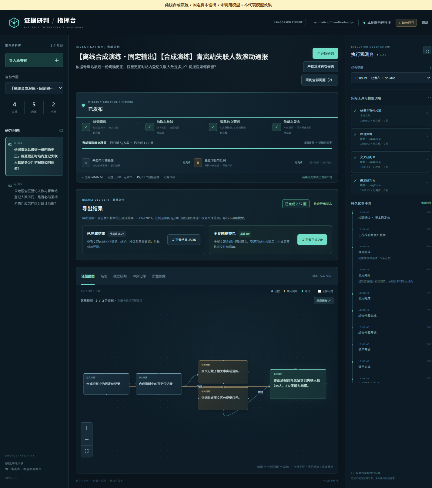
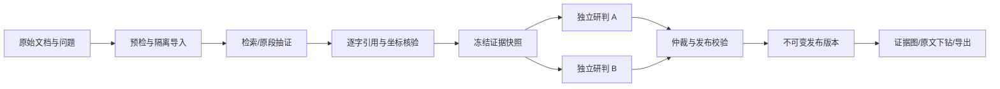

# Trust Judge · 多智能体可信研判与证据链工作台

An evidence-grounded research workbench: import source documents and questions,
run independent analyses, inspect literal citations, and export a versioned
evidence graph. **Vue 3 / TypeScript · FastAPI / Python · LangGraph · SQLite**.

This is the open-source, MIT-licensed public edition of a personal
engineering project. It includes the application, original synthetic examples
and engineering tests. It does not include private development history,
competition source materials, reference answers, provider credentials or
historical model-response archives.



*界面截图来自公开版自带合成资料与固定测试输出，展示真实导入、任务、图谱和
导出链路；未调用模型，不代表真实模型效果、准确率或线上生产表现。*

## 项目解决的问题

把“模型给出一段回答”拆为可以检查的工程流程：资料导入、证据抽取、逐字
核验、两路独立研判、仲裁、版本发布与导出。每条引用可以回到原文段落，
失败、未决和未配置状态保留为明确状态，不用生成的进度或假答案掩盖失败。

个人工作包括前端工作台、API 与任务链路整合、证据与版本约束、模型/框架
适配、回归验证和问题排查；开发过程中使用 AI 编程工具辅助实现，并对
约束和输出进行测试。基础模型、Agent 框架与第三方组件由其上游提供。

### 主要工程能力

- **资料与答案隔离**：运行输入仅接受原始文档及问题；外部 ID 与内部 UUID
  分离，同名资料不会跨专题串用。
- **引用完整性**：保留原文，用 Unicode code point 半开区间定位引用；
  校验原文与片段一致性，重复引文必须有无歧义位置。
- **多步研判**：抽证、核验、共享证据快照、独立 A/B 分析及仲裁；无足够
  支撑时允许 `undetermined`。
- **任务与恢复**：持久任务、事件、取消、幂等请求、检查点与版本边界；
  恢复、重试和新调用分别记录。
- **可观测交付**：展示实际阶段、记录的调用和已知 token 用量；版本固定的
  JSON/ZIP 导出；前端支持证据下钻和排除证据后的影响预览。



## 五分钟了解代码

| 入口 | 看什么 |
| --- | --- |
| [`app/workflows/analysis.py`](app/workflows/analysis.py) | LangGraph 流程、并行分析、检查点及发布前边界 |
| [`app/domain/spans.py`](app/domain/spans.py) | 原文片段与 Unicode 坐标核验 |
| [`app/repository.py`](app/repository.py) | 任务、事件、幂等与版本持久化 |
| [`app/data/import_service.py`](app/data/import_service.py) | 导入预检、答案字段隔离、容量限制 |
| [`web/src/`](web/src/) | Vue 工作台、任务状态、证据图与引用下钻 |
| [`tests/test_import_scenarios.py`](tests/test_import_scenarios.py) | 合成资料导入→worker→图谱→导出的回归案例 |

## 快速开始

要求 Python **3.12/3.13**、[uv](https://docs.astral.sh/uv/)、Node.js
**22.12+**（推荐 Node.js 24）和 npm。服务默认只监听本机。

```sh
git clone https://github.com/regualtoryai-oss/trust-judge-open.git
cd trust-judge-open
uv sync --locked
uv run trust-judge init
uv run python scripts/demo_offline.py
```

最后一条命令只用自带合成资料建立独立临时库、验证重复导入及逐字坐标，
不会读 `.env`、联网或调用模型；它不是模型推理演示或准确率测试。

三个终端分别执行：

```sh
# 终端 1：API
uv run trust-judge serve --port 8790

# 终端 2：持久 worker
uv run trust-judge worker

# 终端 3：前端
cd web
npm ci
npm run dev
```

访问 **http://127.0.0.1:5190**；API 文档位于
**http://127.0.0.1:8790/docs**。前端代理 `/api` 至 `127.0.0.1:8790`。
Windows 也可在依赖安装后运行 `./scripts/dev.ps1`，停止时使用
`./scripts/dev.ps1 -Stop`。

### 不配置模型时可以做什么

在工作台导入 `fixtures/import_samples/` 任一子目录的 `input.json`，
查看资料、问题和预检结果。导入不调用模型。未配置模型时研判按钮禁用，
API 明确返回未配置错误；默认服务不会偷偷使用测试 provider。

### 启用自己的模型

将 `.env.example` 复制为 `.env`，在本机填写：

```dotenv
TRUST_MODEL_PROVIDER=openai_compatible
TRUST_MODEL_NAME=your-compatible-model-name
TRUST_MODEL_API_KEY=
TRUST_MODEL_BASE_URL=https://api.openai.com/v1
```

配置后重启 API 与 worker。适配器使用 LangChain 的 OpenAI 兼容接口与
结构化输出；不同供应商的兼容性需单独验证。真实研判会产生供应商费用，
阶段输出额度是容量上限而非预计实际消费。不要把 `.env` 提交到 Git。

### 查看非空离线界面（显式固定输出）

完成前端构建后，可运行 `uv run python scripts/serve_offline_demo.py`，访问
**http://127.0.0.1:18790**。它用测试专用 provider 和三组合成资料运行真实
导入、worker、图谱和导出链路，界面顶部明确标记“固定脚本输出、未调用模型”。
此入口只供查看已有合成结果和导出，不处理新的研判任务，也不记录虚构的
模型 token 用量；它不是实时模型效果演示。正常工作台不会启用此 provider。

## 验证

```sh
uv run pytest -q
cd web
npm test
npm run build
```

Python 测试默认阻止外部网络，模型回复由测试显式注入。自带三组合成资料
覆盖时点更正与口径、资料不足与未决、重复引文及资料中的恶意指令。
这些验证证明对应工程约束，**不证明真实模型语义质量或提示注入防御率**。

可选 DSH 适配代码位于 `integrations/dsh/`，其依赖需单独安装；它不是默认
工作台运行路径。依赖本机封印研究档案的历史付费探测运行器不在公开版本中。
默认后端套件按 `optional_dsh_runtime` 标记显式跳过需要未分发 tokenizer/SDK
资产的原生集成测试（实际数量见测试汇总）；
准备对应固定资产后可使用 `--run-dsh-integration` 单独启用。它们不计为已通过。

架构与取舍见 [`docs/architecture.md`](docs/architecture.md)，评测口径和
可重跑命令见 [`docs/evaluation.md`](docs/evaluation.md)，公开范围见
[`docs/public-edition.md`](docs/public-edition.md)。

## 当前边界

- 项目已有可运行工程和回归验证，尚无持续外部生产使用的证明。
- 真实模型的抽证精确率、召回率和冲突判定仍有改进空间；不宣称已达到
  比赛或预测评分标准。引用能逐字定位不等于语义结论正确。
- 这是证据研判工具，尚未实现预测概率校准、按事件结算评分、宏观经济
  多主体仿真或前瞻回测；不能把本项目当作已完成的预测引擎。
- 当前是本地单操作员工作台，不包含生产级多租户身份认证。
  人工锁定和复核工作流仍未完成；相关接口明确返回未实现状态。
- 部分研究脚本依赖外部原始样例或模型资产；默认启动与自带合成样例不依赖它们。

## 开源范围

MIT 覆盖本项目自有代码、合成样例及文档；第三方组件保留其原许可证。
详细范围见 [`NOTICE.md`](NOTICE.md)。原始比赛资料、客户数据、账户信息、
运行数据库、模型权重及私有历史报告不随代码发布。
